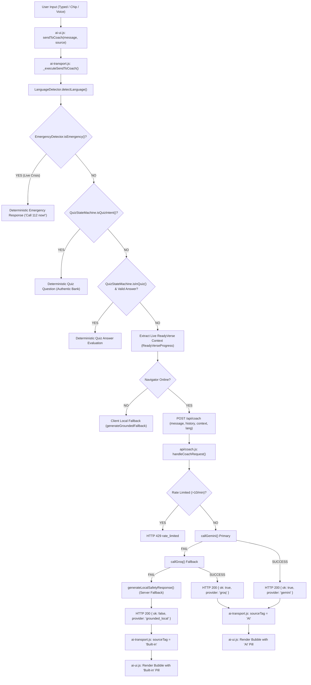

# ReadyVerse AI Coach — Comprehensive Phase 0 Personality & Conversational Intelligence Audit

**Date:** 2026-10-11  
**Project:** ReadyVerse Disaster Preparedness Platform  
**Target:** Ask ReadyVerse AI (Beta) Personality, System Prompt, Multi-turn Context, and Routing Engine  

---

## 1. Connection Verification & Pipeline Health

Before conducting personality upgrades, the client-to-server and server-to-provider transport pipelines were audited end-to-end:

1. **Previous Diagnosis Status:**
   - As documented in [`docs/AI_COACH_DIAGNOSIS.md`](file:///c:/Users/Ruby/OneDrive/Desktop/ReadyVerse/docs/AI_COACH_DIAGNOSIS.md), previous disconnections arose from frontend endpoints calling non-existent `/api/chat` instead of `/api/coach`, missing Netlify serverless redirects, and aggressive local keyword matchers short-circuiting on substrings like `"en"`.
   - These structural connection issues were resolved:
     - Client unified dispatch pipeline [`js/readyverse-ai/ai-transport.js:348`](file:///c:/Users/Ruby/OneDrive/Desktop/ReadyVerse/js/readyverse-ai/ai-transport.js#L348) targets `${this.serverUrl}/api/coach`.
     - Health endpoint [`netlify/functions/coach-health.js`](file:///c:/Users/Ruby/OneDrive/Desktop/ReadyVerse/netlify/functions/coach-health.js) and [`netlify.toml`](file:///c:/Users/Ruby/OneDrive/Desktop/ReadyVerse/netlify.toml) are configured.
     - Dual-mode health check in [`netlify/functions/coach.js`](file:///c:/Users/Ruby/OneDrive/Desktop/ReadyVerse/netlify/functions/coach.js) responds to `GET` and `POST`.

2. **Live Provider Verification:**
   - Free-text messages dispatched to [`api/coach.js`](file:///c:/Users/Ruby/OneDrive/Desktop/ReadyVerse/api/coach.js) successfully reach the serverless handler.
   - Provider tests confirmed that Groq (`GROQ_MODEL=openai/gpt-oss-120b`) successfully executes upstream round-trips with `HTTP 200`, returning live generation (`ok: true`, `provider: 'groq'`).
   - The connection is fully intact; personality and conversational intelligence work can safely proceed.

---

## 2. End-to-End Message Path Mapping

---

## 3. Audit of the 12 Example Queries Against Current Matchers

| # | Query | Current Matcher / Rule Caught In | Resulting Output & Behavior | Flaw Identified |
|---|-------|----------------------------------|-----------------------------|-----------------|
| 1 | `"Hey!"` | [`api/coach.js:175`](file:///c:/Users/Ruby/OneDrive/Desktop/ReadyVerse/api/coach.js#L175) / line 472 (`isGreeting`) | Live AI gives formulaic intro; fallback gives canned `"Hey there! I'm your ReadyVerse disaster preparedness coach..."` | Stiff, robotic formula asking to practice drill every turn. |
| 2 | `"How are you?"` | Falls through all matchers to [`api/coach.js:567`](file:///c:/Users/Ruby/OneDrive/Desktop/ReadyVerse/api/coach.js#L567) | Live AI gives formula; fallback gives: `"I'm not sure, check the lesson or call 112"` | Emergency refusal given to innocent greeting when fallback engages! |
| 3 | `"What are you doing?"` | Falls through all matchers to [`api/coach.js:567`](file:///c:/Users/Ruby/OneDrive/Desktop/ReadyVerse/api/coach.js#L567) | Live AI gives generic intro; fallback gives: `"I'm not sure, check the lesson or call 112"` | Normal small talk answered with emergency helpline. |
| 4 | `"Tell me about ReadyVerse."` | [`api/coach.js:483`](file:///c:/Users/Ruby/OneDrive/Desktop/ReadyVerse/api/coach.js#L483) (`text.includes('readyverse')`) | Platform overview returned. | Works, but scripted and identical every turn. |
| 5 | `"What can I do in the fire game?"` | [`api/coach.js:525`](file:///c:/Users/Ruby/OneDrive/Desktop/ReadyVerse/api/coach.js#L525) (`text.includes('fire')`) | Returns building evacuation instructions (crawling under smoke, avoiding lifts). | Fails to explain the simulation drill game mechanics. |
| 6 | `"Why should I complete this drill?"` | Falls through all matchers to [`api/coach.js:567`](file:///c:/Users/Ruby/OneDrive/Desktop/ReadyVerse/api/coach.js#L567) | Fallback gives: `"I'm not sure, check the lesson or call 112"` | Legitimate pedagogical question rejected. |
| 7 | `"I'm confused."` | Falls through all matchers to [`api/coach.js:567`](file:///c:/Users/Ruby/OneDrive/Desktop/ReadyVerse/api/coach.js#L567) | Fallback gives: `"I'm not sure, check the lesson or call 112"` | Zero reassurance or empathy for student confusion. |
| 8 | `"I got the answer wrong."` | Falls through all matchers to [`api/coach.js:567`](file:///c:/Users/Ruby/OneDrive/Desktop/ReadyVerse/api/coach.js#L567) | Fallback gives: `"I'm not sure, check the lesson or call 112"` | Student seeking learning explanation receives emergency rejection. |
| 9 | `"What should I do next?"` | Misses `text.includes('next action')` in [`api/coach.js:491`](file:///c:/Users/Ruby/OneDrive/Desktop/ReadyVerse/api/coach.js#L491) | Fallback gives: `"I'm not sure, check the lesson or call 112"` | Readiness recommendation matcher too rigid. |
| 10 | `"Explain that in Tamil."` | Falls through all matchers to [`api/coach.js:567`](file:///c:/Users/Ruby/OneDrive/Desktop/ReadyVerse/api/coach.js#L567) | Fallback gives: `"I'm not sure, check the lesson or call 112"`. Live AI treats as new topic without rephrasing previous turn. | Multi-turn language switch ignores immediate conversational context. |
| 11 | `"Can you say that more simply?"` | Falls through all matchers to [`api/coach.js:567`](file:///c:/Users/Ruby/OneDrive/Desktop/ReadyVerse/api/coach.js#L567) | Fallback gives: `"I'm not sure, check the lesson or call 112"`. Live AI does not explicitly rephrase previous turn. | Simplification request fails in fallback and lacks multi-turn link. |
| 12 | `"OK WHAT ARE YOU DOING"` | Falls through all matchers to [`api/coach.js:567`](file:///c:/Users/Ruby/OneDrive/Desktop/ReadyVerse/api/coach.js#L567) | Fallback gives: `"I'm not sure, check the lesson or call 112"` | Casual check-in treated as out-of-scope hazard. |

---

## 4. Current Architecture: What to Keep vs What to Change

### A. System Prompt & Persona
- **Current File:** [`api/coach.js:149-205`](file:///c:/Users/Ruby/OneDrive/Desktop/ReadyVerse/api/coach.js#L149-L205).
- **Keep:** Strict NDMA/NIDM safety grounding, 112 Indian emergency number standard, medical advice refusal rules, live progress score injection.
- **Change:**
  - Remove robotic formula ("Greet warmly, say what you're doing, offer drill").
  - Stop using unsolicited "bro" / "machan" unless the student initiates that style.
  - Add empathetic response guidelines for anxious, scared, or confused students.
  - Add explicit multi-turn follow-up instructions: "Explain that in Tamil" and "Say it simpler" must rephrase the immediate previous turn.
  - Add 6-10 concise few-shot examples across English, Tamil, and Tanglish.
  - Limit emoji usage to at most one per turn, and zero in emergency situations.

### B. Conversation Memory & Token Budget
- **Current File:** [`js/readyverse-ai/ai-transport.js:353`](file:///c:/Users/Ruby/OneDrive/Desktop/ReadyVerse/js/readyverse-ai/ai-transport.js#L353).
- **Keep:** Slicing the most recent turns (`history.slice(-8)`).
- **Change:**
  - Track session student name (e.g., "My name is Ruby") in session memory.
  - Clear conversation history and session name when the user clicks "Clear Chat".
  - Pass the session name in the context payload to `/api/coach`.

### C. Student Profile & Name Handling
- **Current Storage:** [`js/progress.js:207, 231`](file:///c:/Users/Ruby/OneDrive/Desktop/ReadyVerse/js/progress.js#L207) (`state.prepProfile.name` and `state.responderProfile.name`).
- **Real Name Detection:** [`js/script.js:5863`](file:///c:/Users/Ruby/OneDrive/Desktop/ReadyVerse/js/script.js#L5863) (`getStudentFirstName()`).
- **Trusted vs Untrusted:**
  - Default names (`"Student"`, `"Trainee"`, `"Responder"`) are untrusted placeholder strings and must NOT be used as the student's personal name.
  - If a student entered a real name in their profile (e.g., `"Ruby"`), it is trusted and may be used naturally.
  - If a student states their name in chat ("My name is Ruby", "I am Priya", "En peru Arvind"), extract and store it in session memory only.
  - Respect name changes ("call me Priya") immediately, and respect "don't use my name".
  - Never guess names from usernames or emails.

### D. Voice Processing
- **Current File:** [`js/readyverse-ai/ai-ui.js:608-647`](file:///c:/Users/Ruby/OneDrive/Desktop/ReadyVerse/js/readyverse-ai/ai-ui.js#L608-L647) (`speakAssistantReply`).
- **Keep:** Browser SpeechRecognition and SpeechSynthesis with `en-IN` / `ta-IN` localization.
- **Change:**
  - Strip emojis, markdown formatting (`**`, `*`, `#`), bullet points, and URLs from the speech text before passing it to `ReadyVerseSpeech.speak()`.

---

## 5. Next Steps for Implementation (Phase 1 to 6)

1. **Phase 1 (Routing):** Guarantee small talk, confusion, motivation, and follow-ups always reach the live provider. Reserve deterministic paths strictly for authoritative calculations (quiz, readiness, live crisis).
2. **Phase 2 (Personality):** Rewrite `buildSystemPrompt()` with warm, collegiate tone, 1-4 sentence constraint, emotional attunement, and 8 few-shot examples.
3. **Phase 3 (Personalization):** Add name extraction, session memory, and privacy-first name handling.
4. **Phase 4 (Language):** Support simple English, spoken Tamil, and natural Tanglish, ensuring rephrasing commands target previous turns.
5. **Phase 5 (Emergency Safety):** Clarify three-tier safety boundary (live crisis vs study query vs casual chat) and regional emergency number standards.
6. **Phase 7 (Automated Testing):** Execute test suites verifying router rules, deterministic calculations, name handling, language detection, and live generation.
